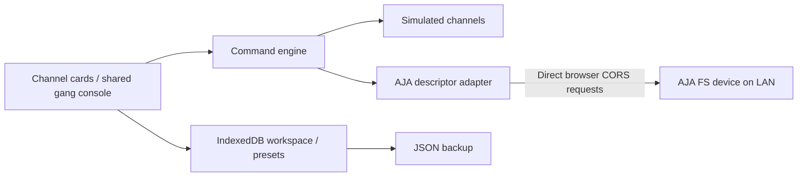

# Architecture

The React/TypeScript application is statically built by Vite. GitHub Pages serves only assets. There is no backend, proxy, telemetry, external font request, or Companion runtime dependency.

## Boundaries

- `core/types.ts` defines channels, devices, parameter descriptors, presets, and adapters.
- `core/store.ts` owns commands, per-device serialization, gesture history, readback, and workspace updates. Relative adjustments accumulate; queued updates from a slider gesture coalesce. Every operation deduplicates channel targets.
- `core/color.ts` provides numeric quantization, compatibility, and common/mixed value calculation. Its conventional control definitions power simulation; hardware metadata comes from readable device descriptors instead.
- `adapters/aja.ts` reads `desc.json`, recognizes a conservative allowlist of SDR color controls, reads native parameters, and guards the active source context around writes. Unknown or ambiguous metadata is not writable.
- `core/persistence.ts` validates versioned JSON with Zod and persists it to IndexedDB. Hardware status, armed state, and freshness are cleared when loading. Credentials are held only by the in-memory adapter.

## Command lifecycle

An adjustment identifies an explicit channel set, semantic parameter, relative/absolute intent, and source context. Each device has one serialized write queue. Hardware values are freshly read before computing the target. The adapter checks source context again, sends the set command, reads the value back, and checks context after the write. Confirmed results update the UI and undo history.

After an uncertain hardware write, the device is disarmed, marked offline, and remaining queued jobs are discarded. No retry or rollback occurs automatically. Reconnect runs the diagnostic path and requires explicit arming again. A group spanning devices may partially succeed, and results are reported per member.

Polling refreshes foreground hardware state every five seconds when the device is idle. Polling and writes share the device queue ownership. Cached values older than fifteen seconds cannot initiate writes. The adapter currently favors conservative full-state reads; measure polling and write latency on each device before adjusting limits or optimizing reads.

## Ownership and storage

The Web Locks API holds one control owner per browser origin/profile. Additional tabs are read-only. This is a local coordination feature, not distributed ownership or device authentication. Browser storage and Web Locks are origin-scoped; deploy one SignalShade installation per origin when isolation matters.

Workspace imports validate structure, ranges, IDs, references, and size; loading sends no network writes. Presets carry parameter metadata so recalls can reject incompatible units, scaling, enums, resolutions, and device models before enqueueing commands. There is no cross-model color equivalence assumption.

## Selection and controls

Channel cards show a small Quick control set by default, with label and numeric entry on one row. Tabs expose Proc amp or RGB correction at a time, with native range sliders, arrow nudges, numeric entry, and parameter/section/channel resets. RGB correction shows one family at a time in Red / Green / Blue order, with Gain selected initially and Black/Gamma available as subtabs. Legalizer is gated from presentation, customization, and preset recall; UI resets exclude its parameters. Existing Legalizer values, mappings, and preset data are retained for later use. Quick controls ignore section hiding and fall back to supported descriptors when a processor does not expose the pinned set. Presentation-only recovery restores the four default Quick controls and all tabs without resetting signal values. Validation repairs legacy layouts that hid every section; customization prevents hiding the final tab. Card commands always target one channel. Temporary multi-selection is UI state, separate from saved gangs; both use the same shared console and command engine. Saved gang masks apply only to the shared controls. Selection changes never enqueue writes.

Mouse drags begin on card headers or any non-interactive channel-pane background, including whitespace outside the grid. The pane owns pointer capture and hit-tests its visible channel cards. Controls, tab lists, editable content, the gang console, native scrollbars, and non-mouse pointers are excluded; pointer cancellation or lost capture clears the marquee. The marquee previews membership while keeping console geometry stable, then commits membership on release. Ctrl/Command toggles a clicked card or adds intersected cards during a drag. Touch and keyboard users can select through the header buttons; Select visible is available in the toolbar.

## Visual palette

`src/theme.ts` contains the single active dark broadcast palette. Component CSS uses semantic custom properties for surfaces, text, borders, the gold accent, statuses, RGB control tracks, section accents, and RGB family accents. Proc amp and RGB have distinct section tints; Gain, Black, and Gamma have labeled family accents across group columns and card subtabs. Saved gang colors mark the console header, selected member borders, and membership tags. The palette is applied before React renders; there is no theme picker, saved theme preference, or alternate theme yet. To reskin later, change the palette rather than individual component styles. Keep the static favicon, browser theme-color, and initial dark background fallback aligned with the palette. Custom gang colors remain part of each workspace.

## Offline and updates

Vite emits a versioned service worker containing the app shell and hashed assets. Only same-origin application assets under the build base are eligible for caching. LAN URLs and API requests are never intercepted. A waiting worker is activated only by the operator’s update control, or after all old clients close. A clean first load still requires access to Pages.
