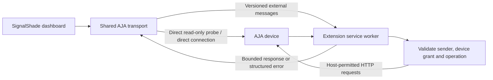

# SignalShade Connect — Chrome extension bridge

Status: GitHub preview implementation, 2026-10-15. See [extension README](../extension/README.md) for installation, scope, and remaining qualification. Not submitted to the Chrome Web Store.

Preview implementation differs from the target design below: a production-page-only content relay discovers unpacked installations without a stable store ID; it forwards messages to the service worker, which performs network requests. Installation is manual through Developer mode. In v0.2.0, an extension-owned approval frame is embedded in the connection dialog and the pending Connect action resumes after approval. Permissions are revoked using Chrome's extension settings. Multi-tab writes have a 30-second ownership guard, not the proposed explicit takeover UI. The extension recovers descriptors after worker restarts. Configured recorders resume monitoring on load and retain control intent only within the current tab and after fresh verified state; uncertain commands disarm it. Basic HELO Plus connectivity was reported working by the user; wider hardware/browser qualification remains pending.

## Outcome

Let the hosted SignalShade dashboard monitor and control permitted AJA devices even when their REST responses cannot be read by a normal cross-origin browser request. No installed server, terminal commands, network scanning, extension settings form, or duplicate device configuration.

Proposed store name: **SignalShade Connect**. Its single purpose is connecting the SignalShade dashboard to the user's AJA equipment. The dashboard remains the place for device addresses, labels, passwords, control enablement, and monitoring.

Chrome extension service workers can perform cross-origin requests with host permissions. Content scripts alone do not solve this problem. The extension performs requests itself; it does not alter global CORS headers or disable browser security.

## User experience

1. User adds a device in SignalShade as today and clicks Connect.
2. SignalShade checks for the known extension ID with a versioned handshake. If installed and already authorized for this device, use the extension. Otherwise attempt the existing direct, read-only connection.
3. If a direct request fails at the browser boundary, display a small inline notice in that device's connection area:

   **Browser connection blocked**  
   SignalShade Connect may resolve browser restrictions when connecting to this device.  
   **Install SignalShade Connect** · **Retry** · **Details**

   Do not label every fetch failure as proven CORS: JavaScript cannot reliably distinguish CORS, network failure, and some policy restrictions. HTTP authentication errors, invalid descriptors, and model mismatches get their own messages, not an install prompt.

4. Install opens the official Chrome Web Store listing in a new tab. Chrome handles installation approval. The site never installs silently, uses inline-install APIs, or asks users to enable Developer Mode.
5. On return to SignalShade, check again on window focus and on an **I've installed it** action. Do not promise an automatic installation notification. If unavailable, explain disabled extension, managed-browser policy, or a required reload as possible causes.
6. User clicks **Allow device connection**. A minimal extension-owned approval window displays the requested model, address, and **Allow connection** button. Nothing to type. That button calls Chrome's optional permission request from a genuine user gesture; do not depend on gesture propagation from a website message.
7. Once approved, run read-only discovery and show **Connected via SignalShade Connect** in device details. Recorder control remains separately disabled until enabled in SignalShade, as it is today.
8. Future visits reuse Chrome's saved host grant. The user still reconnects real recorders and enables control for the session. New device hosts require approval; already granted hosts do not.

The extension icon opens only a small status surface: name, version, **Open SignalShade**, and privacy/help links. No address entry, transport selector, or tuning options. Connection revocation belongs in the dashboard's device details, with Chrome's own extension permissions as a fallback. Revocation must explain when another configured device shares the host grant.

## Architecture

Introduce an `AjaTransport` interface beneath FS and recorder adapters. Preserve existing parsing, polling, queues, lock enforcement, and command readback. Implement direct-fetch and extension transports. Route consistently per device session; no mixed transport authentication state.

The extension accepts structured operations, not arbitrary fetch requests:

- `hello`: protocol version, extension version, supported operation families.
- `permissionStatus` / `requestDeviceAccess` / `revokeDeviceAccess`.
- `openDevice` / `closeDevice`: create an opaque session bound to the requesting tab/document and validated device origin.
- `readDescriptors`, `readParameter`, `writeParameter`, `login`.

Every message has a schema version, request ID, bounded payload, and deadline. Responses include matching ID and a typed result/error. Errors distinguish permission denied/revoked, offline/timeout, HTTP/authentication, invalid response, unsupported operation, incompatible extension, and unknown command outcome. Never return credentials, cookies, or authentication response headers to the page.

Protocol handlers and supported parameter/write rules are bundled with the extension. Remote descriptor JSON is data; it cannot expand the packaged operation allowlist or supply executable logic. Parameter identifiers, values, and enums are independently validated inside the extension. Recorder writes remain Record/Stop only, with exact family-specific IDs and values. FS writes are limited to supported shading parameters and validated ranges. No arbitrary paths, methods, headers, scripts, uploads, firmware updates, media formatting, or general proxy capability.

## Permissions and trust boundary

- Manifest V3, background service worker, packaged JavaScript, and `storage` only where session/config metadata requires it.
- `externally_connectable` admits the production dashboard URL pattern. Independently validate browser-supplied sender URL/origin and top-level context in every handler. Production does not admit localhost, preview deployments, arbitrary extensions, or wildcard GitHub Pages tenants.
- Restrict to `https://inertiaimpact.github.io/SignalShade/` and its intended routes. Path checks are defense in depth, not isolation between applications sharing the same web origin. A dedicated SignalShade domain is preferable before broad distribution, especially if unrelated apps share this origin.
- Device addresses come only from the user's dashboard configuration and explicit approval. Initial release supports canonical RFC1918 IPv4 literals over HTTP/HTTPS; no public IPs, hostnames, loopback, link-local, embedded credentials, or redirects. No LAN scanning. This intentionally narrows the extension beyond the existing direct adapter address validator.
- Declare optional HTTP/HTTPS host patterns to support addresses discovered at runtime; request only the exact device host when the user approves. Explain broad optional declarations in the store review. Host permissions cannot express arbitrary private CIDRs or fully restrict ports/paths, so enforce the exact approved scheme/host/port and endpoints in code as well.
- No mandatory all-sites access, content scripts, browsing-history permission, debugger permission, native messaging host, proxy settings changes, or request-header rewriting.
- A permission grant is connection authority, not automatic permission to start recording. Keep existing application control enablement, desk lock, and stop confirmation; tie extension write authorization to the active session. A trusted dashboard compromise remains a risk and is not solved by message IDs or tokens.
- Reject redirect responses, malformed/canonicalization tricks, oversized responses, expired sessions, unknown message types, and requests from unrelated frames/tabs. Limit concurrency, message rate, and response size, allowing for measured AJA descriptor sizes (the supplied HELO Plus descriptor is about 585 KB).

## Authentication, reliability, and production behavior

The browser/extension stays on the same reachable network or VPN as the equipment. This does not provide remote access or bypass corporate browser policy.

Use the AJA login endpoint where required. Passwords live only in the active extension session, never in sync storage, workspace exports, telemetry, or logs. Prefer extension-restricted session storage for ephemeral session metadata where worker restarts require it. Cookie-based authentication must be tested under current Chrome rules; do not promise every firmware login flow works, and do not request blanket cookie access as a speculative workaround.

MV3 workers can stop and restart. Register listeners at worker startup; do not depend on persistent global variables, timer loops, or artificial keep-alive. Dashboard owns polling and requests work as needed. Restore non-secret session bookkeeping safely or require reconnect. Closing the dashboard stops monitoring, not the physical recording. Background-tab throttling/sleep can delay status updates; stale timestamps remain visible.

Reads may retry within bounded limits. Writes are never automatically replayed across timeouts, worker restarts, transport changes, or extension updates. Persist short-lived pending write IDs before dispatch and reconcile uncertain outcomes through fresh reads; duplicates return an existing/unknown outcome rather than writing again. A failed write must never trigger direct-to-extension fallback. Transport switching is a read-only reconnect and disarms control.

Serialize writes per appliance across dashboard tabs. Use one controlling session per appliance with other sessions read-only; show conflicts in SignalShade. Session takeover requires an explicit dashboard action and never replays queued commands. Extension updates or protocol incompatibility disarm control and request reconnect.

## Implementation sequence

1. **Prove the route:** create a minimal unpacked MV3 prototype and test descriptor, Product ID, and record-state reads against the actual HELO Plus. Verify exact-host permissions, private HTTP access, current Chrome network policy, and authenticated reads before expanding the UI. This is developer qualification, not the end-user installation flow.
2. **Build the transport:** extract shared direct transport, add typed extension messages, sender/target validation, permission approval window, session handling, and structured failures. Keep direct connections working.
3. **Integrate the dashboard:** installation prompt, known-ID handshake, return detection, per-device permission request, automatic authorized route selection, unobtrusive connection status, revoke/reconnect actions, and version compatibility handling.
4. **Qualify control:** verify Record/Stop readback and stream independence on HELO Plus, then HELO/Ki Pro families and FS shading. Use hardware-qualified support labels; extension connectivity alone does not prove adapter compatibility.
5. **Prepare distribution:** create developer account/listing, reserve stable production extension ID, build reproducible package, privacy policy, icons/screenshots, permission justifications, and reviewer instructions with a simulator that needs no production credentials. Do not package the user's HAR or device export.
6. **Publish:** submit for Web Store review and release the site's install link only when the listing is available. Store approval is not guaranteed. Keep dev/test extension IDs out of production builds; document minimum tested Chrome version and enterprise restrictions.

## Verification and acceptance

- Actual HELO Plus `/config` reads succeed through the extension with normal browser security enabled.
- Fresh install flows from the site's prompt through store installation and exact-host approval without an address being entered twice.
- Permission refusal/revocation and missing/disabled extension produce actionable messages without repeated popups.
- Unit/integration tests reject untrusted origins, same-host wrong paths, subframes, public/loopback targets, redirects, unauthorized ports, arbitrary operations, malformed values, and oversized payloads.
- Browser tests cover worker termination, extension update, duplicate command IDs, timeout after a device accepted a write, multi-tab control conflicts, network loss, and read-only reconnect.
- Read-only setup cannot issue Record/Stop or FS changes. Desk lock and session enablement remain effective.
- Existing direct connections, simulated devices, and browser-only workflows continue working without the extension.
- Authentication tests cover password-free and password-protected devices; media/duration accuracy remains separately hardware-qualified.
- No settings page, duplicated equipment list, telemetry, cloud relay, or retained passwords. Privacy disclosure explains local device addresses, status, and commands processed between the trusted site and local equipment, including HTTP when the device uses it.

## Sources

- [Chrome cross-origin network requests](https://developer.chrome.com/docs/extensions/develop/concepts/network-requests)
- [External website messaging allowlist](https://developer.chrome.com/docs/extensions/reference/manifest/externally-connectable)
- [Optional permissions and user gestures](https://developer.chrome.com/docs/extensions/reference/api/permissions)
- [Extension service worker lifecycle](https://developer.chrome.com/docs/extensions/develop/concepts/service-workers/lifecycle)
- [Chrome Web Store policies](https://developer.chrome.com/docs/webstore/program-policies/policies)
- [Manifest V3 remote-code requirements](https://developer.chrome.com/docs/webstore/program-policies/mv3-requirements)
